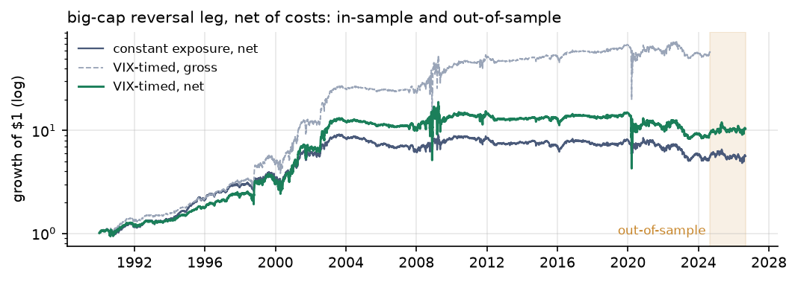

## Quant Crucible

**Paid to Hold the Bag: liquidity provision is a high-fear premium, and that is
exactly why it is hard to size.**

Gator Quant Hacks 2026 · Track 03 Systematic Trading

When markets panic, someone has to sell *now*: a fund meeting redemptions, a
forced de-leverager, an investor reacting to overnight news. Someone else takes
the other side and holds the bag until prices recover. We asked a simple
question: **is that patient buyer paid more when fear is high?** We wrote the
answer down before testing it, tested it three ways on public data, and report
everything, including what failed.

📄 **Quant note:** [`note/quant_note.pdf`](note/quant_note.pdf) · 🧪 **Reproduce:** `python run_all.py --oos` · 🖥️ **Workspace preview:** [hacks-eight-eta.vercel.app](https://hacks-eight-eta.vercel.app/)

---

## Headline findings

All numbers are net of costs. The held-out period (**2024-09-01 → 2026-08-31**)
was evaluated once.

| | Finding |
|---|---|
| ✅ **Module A** · daily reversal, 1990–2026 | Reversal returns rise with yesterday's VIX (Newey–West *t* = 2.4). Since 2004 the large-cap premium exists **only** on the most fearful days (VIX > 24). |
| ❌ **Module A** · leverage rule | Levering up when VIX is high **fails**: risk grows as fast as reward, so the Sharpe doesn't improve. |
| ✅ **Module B** · S&P 500 opening gap fade | Trading only when VIX ≥ 20 turns Sharpe **−0.26 → +0.12** in-sample and **−1.83 → +0.24** on the held-out two years. |
| ❌ **Module C** · price vs. quantity of risk | Our sharper "variance risk premium" signal **lost** to constant exposure, in and out of sample. |
| 💰 **What survives** | A constant-notional large-cap reversal book: net Sharpe ≈ 0.4, break-even cost 14 bps, capacity about **$100M–$500M**. |

**The lesson: choose *when* to show up, not *how much* to bet.**



---

## Hypotheses (written before results)

Each hypothesis was committed **before** its first backtest in
`srinivaspenumarthi/cursor_hack`. The files here are verbatim copies, and each
one lists its original commit.

| File | Module | Idea in one line | Original commit |
|---|---|---|---|
| [HYPOTHESIS.md](HYPOTHESIS.md) | **A** · daily reversal | The reversal premium is a payment for liquidity, and it rises with yesterday's VIX. | `0d0093d` · Oct 3, 10:54 UTC |
| [HYPOTHESIS_B.md](HYPOTHESIS_B.md) | **B** · opening gap fade | Same mechanism at the open: participate only when VIX ≥ 20, don't lever. | `fbd355a` · Oct 3, 11:53 UTC |
| [HYPOTHESIS_C.md](HYPOTHESIS_C.md) | **C** · price of risk | The premium follows the variance risk premium, not realised variance. | `6067ea1` · Oct 3, 18:14 UTC |
| [HYPOTHESIS_8K.md](HYPOTHESIS_8K.md) | Separate study | Selling puts after a buyback 8-K beats selling them on ordinary days. | Not part of the quant note |

**Who's on the other side:** an impatient trader who pays for immediacy.
**Why it persists:** the dealer and arbitrageur capital that would compete it
away is scarcest exactly when the premium is highest (Grossman–Miller 1988;
Brunnermeier–Pedersen 2009; Nagel 2012).

---

## How we kept it honest

- **Pre-registration.** Rules, thresholds, costs and a variant budget were fixed in writing before any test.
- **No lookahead.** Every signal uses only data dated before the trading day, checked by [`tests/test_no_lookahead.py`](tests/test_no_lookahead.py).
- **Realistic costs.** The cost per dollar traded is $c_t = c_{\text{base}} \times \text{VIX}_{t-1}/20$, so spreads widen in a panic. We also report flat costs, doubled costs and break-even costs.
- **Locked held-out period.** The last two years were opened once per module, each in its own commit.
- **All 80 variants reported**, with the Deflated Sharpe Ratio to adjust for the number of trials.
- **Disclosed biases.** Module B uses today's S&P 500 members, so it has survivorship bias. We disclose it and test it by checking that both the long and short legs earn the premium.

---

## Reproduce the research

Python 3.12 is recommended. All data is public (Kenneth French Data Library,
FRED, Yahoo Finance), so **no API keys are needed.**

```bash
git clone https://github.com/Akashchalla/hacks.git
cd hacks
python -m venv .venv && source .venv/bin/activate
pip install -r requirements.txt

python run_all.py --oos      # downloads data, runs Modules A–C, writes results/
python -m pytest -q tests    # includes the no-lookahead checks
```

Outputs go to `results/`: `REPORT.md`, `REPORT_B.md` and `REPORT_C.md` (readable
summaries), `*_in_sample.json` / `*_out_of_sample.json`, `tables/` and `figures/`.
To rebuild the PDF note, run `python note/build_pdf.py`.

The separate 8-K study runs with `python run_eightk.py --start 2023-01-01 --end 2025-12-31`
and needs a Massive API key (see `.env.example`).

---

## Repository map

```
HYPOTHESIS*.md          pre-registered hypotheses (A, B, C, 8K)
run_all.py              one command → every number and figure in the note
data/                   download scripts + frozen S&P 500 constituent list
src/gqh/                signals, backtest, metrics, capacity, reports (Modules A–C)
results/                in-sample / held-out outputs, tables, figures, reports
note/                   quant note (Markdown source + PDF + build script)
tests/                  no-lookahead, strategy and pricing tests
live/                   Quant Crucible AI workspace (paper trading + research agent)
voice_ui/               React voice/chat frontend for the workspace
filing_edge/            Massive data bonus-track study (separate submission)
```

---

## Bonus: the Quant Crucible workspace

Alongside the research, we built an AI workspace that lets you **question the
research instead of just reading it**. You can ask, by voice or text, *why* a
trade happened, what would break the strategy, or how it held up in a crash.

- **Gemini** routes questions and explains the evidence.
- **Deterministic Python tools** do all the arithmetic. The model never makes up a number.
- **Repository evidence retrieval** grounds every answer in the hypotheses, results and risk logic in this repo.
- **ElevenLabs** provides full-duplex voice. Text and voice share one pipeline.
- The broker layer is **simulated / paper-only**.

**🖥️ Try the interface:** [hacks-eight-eta.vercel.app](https://hacks-eight-eta.vercel.app/)
This hosted page shows the workspace layout and views. The AI chat, voice and
live data need the Python backend (`live/voice_api.py`), which runs locally with
your own keys, so those panels stay offline on the hosted preview.

It doesn't affect the research results above. To run it you need your own API
keys in a `.env` file (copy `.env.example`). Quick start: `streamlit run live/dashboard.py`.
For the full voice setup, see [`FINAL_START.md`](FINAL_START.md) and
[`QUANT_CRUCIBLE.md`](QUANT_CRUCIBLE.md).

---

## Team

Jyothi Nandhan Repaka · Akash Challa · Manikanta Srinivas Penumarthi . Ajitesh Reddy Byreddy

## Key references

Grossman & Miller (1988) · Jegadeesh (1990) · Brunnermeier & Pedersen (2009) ·
Bollerslev, Tauchen & Zhou (2009) · Nagel (2012) · Berkman et al. (2012) ·
Bailey & López de Prado (2014) · Lou, Polk & Skouras (2019). The full list is in the note.
